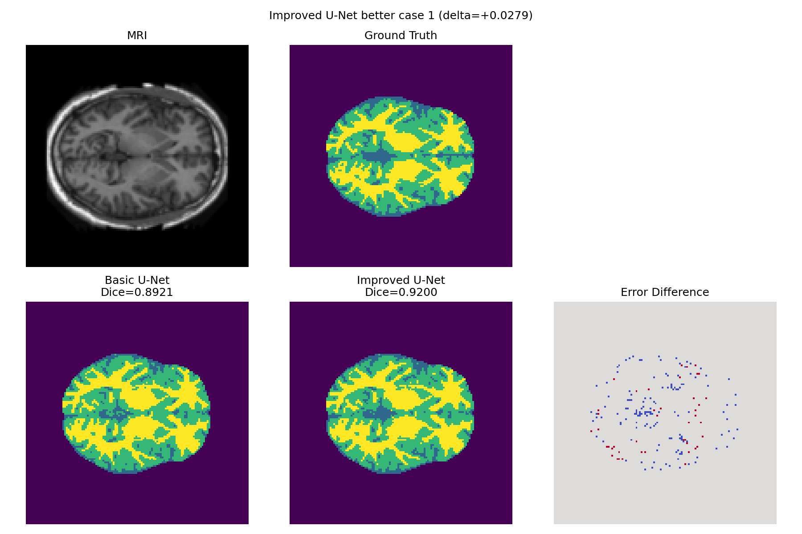
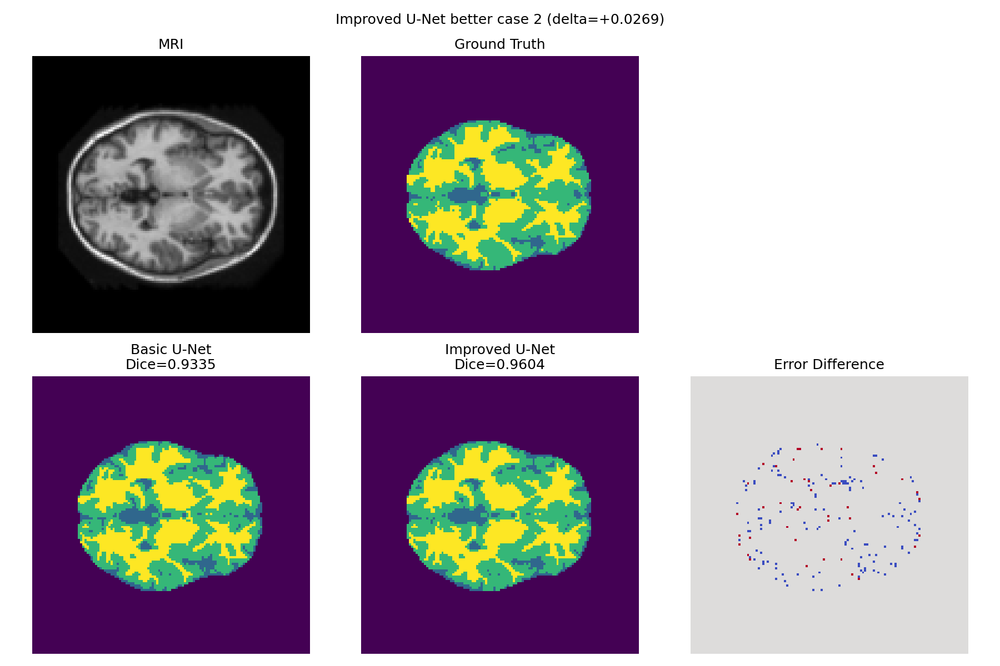
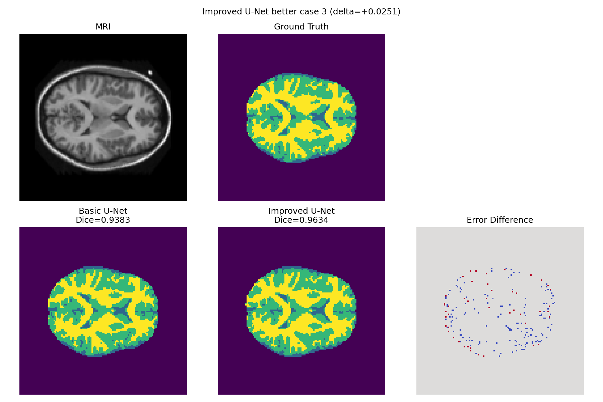
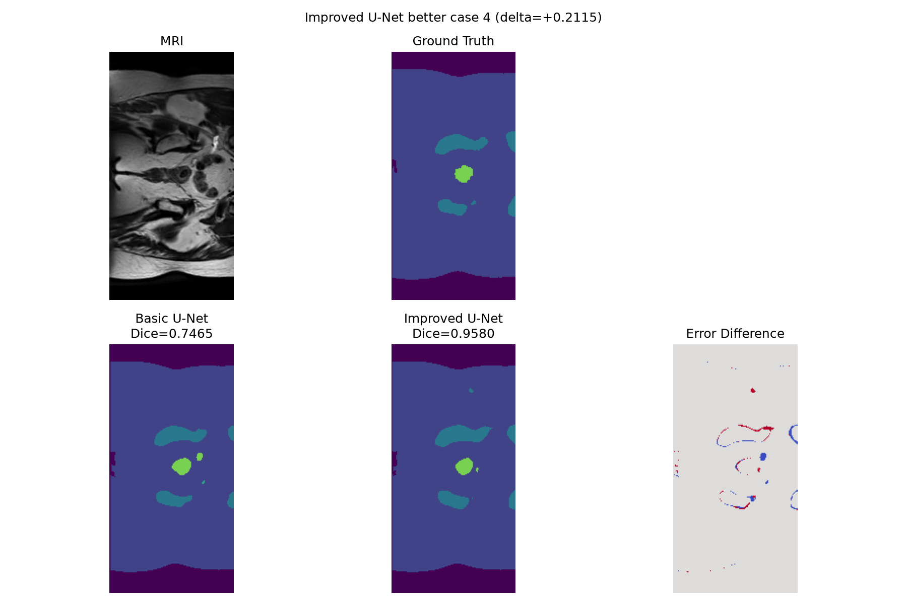
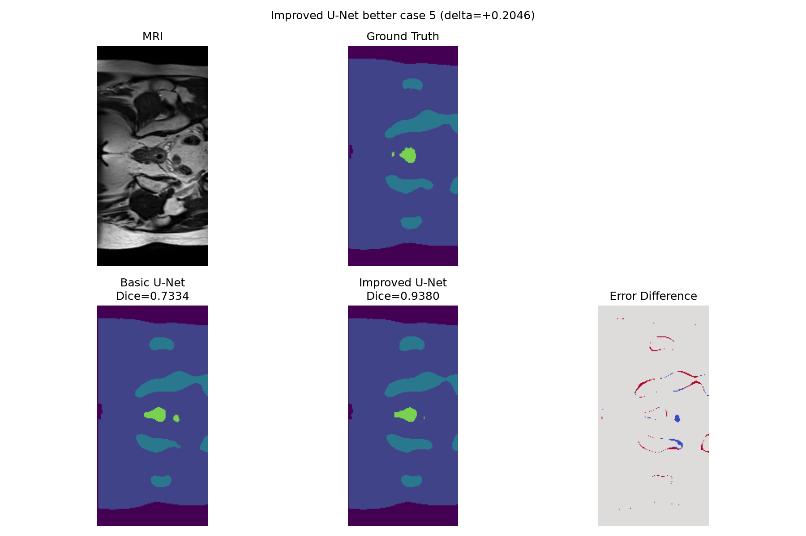
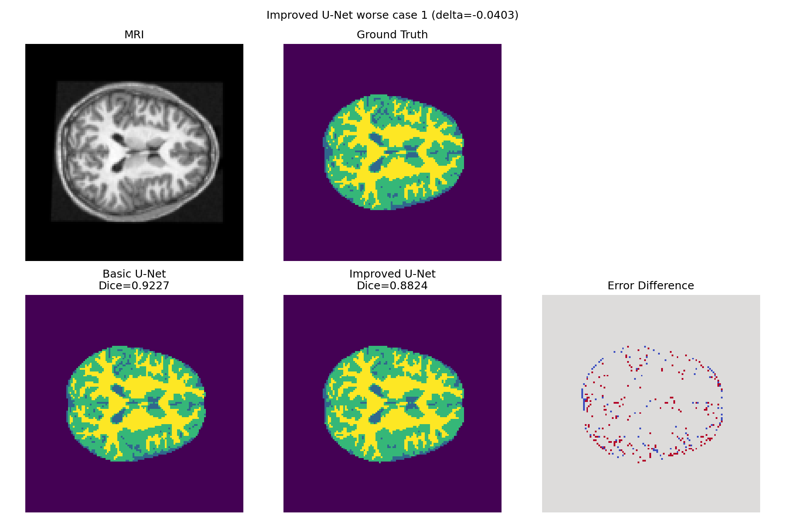
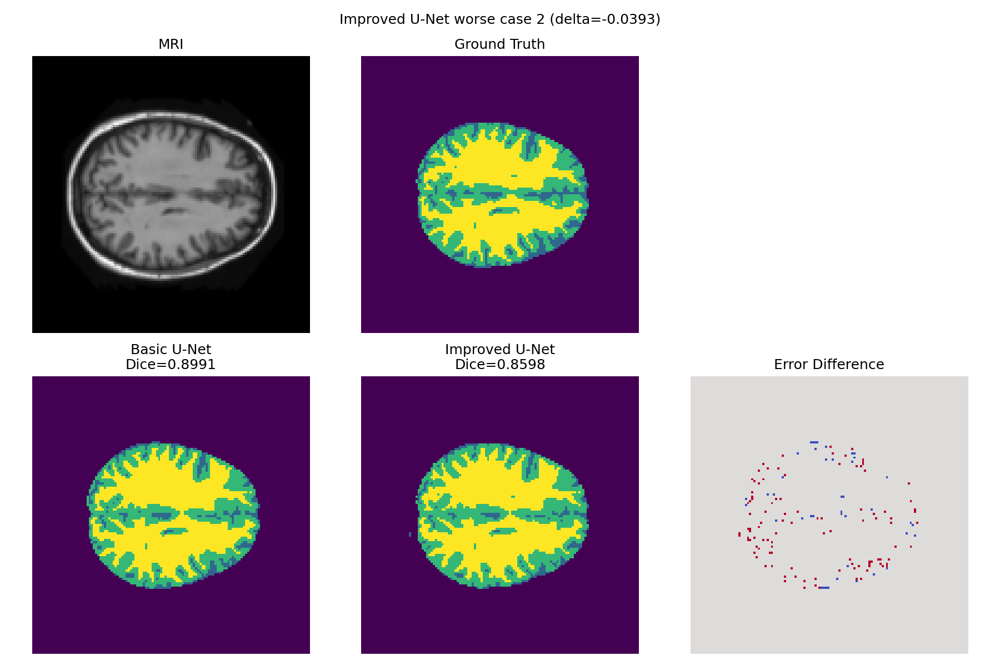
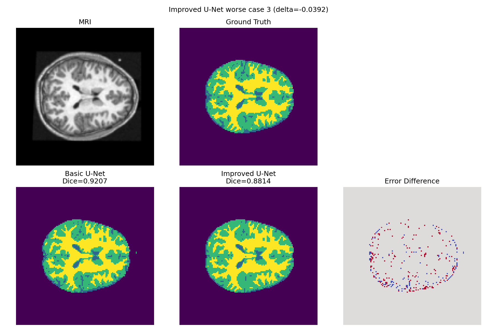
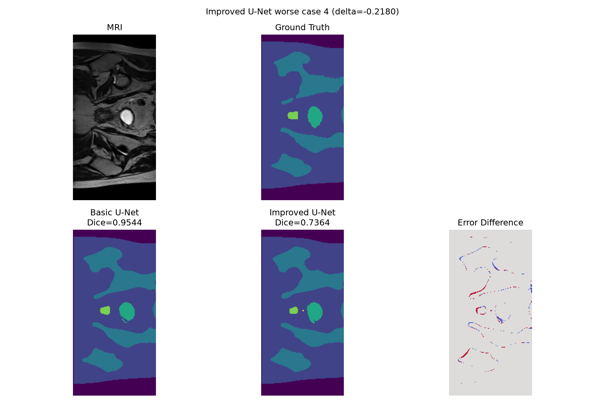
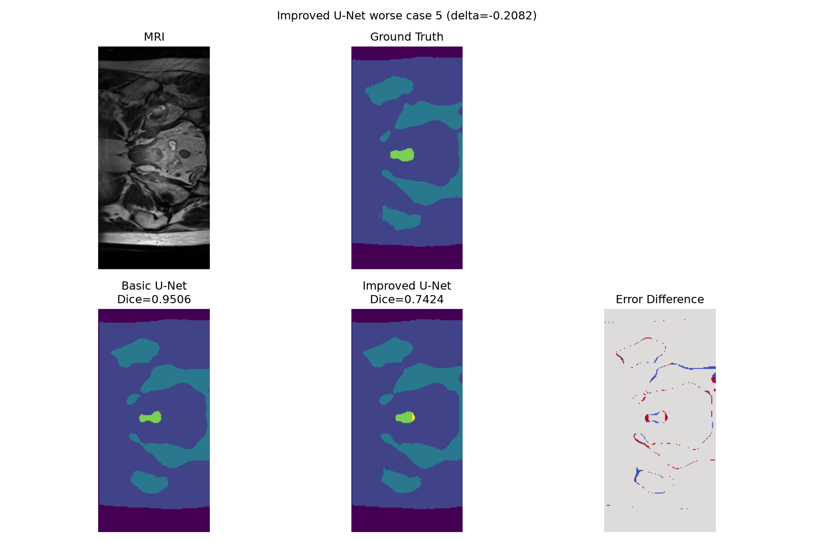

# HipMRI Prostate Segmentation with an Improved U-Net

## Overview

This project investigates 2D semantic segmentation of pelvic MRI slices from the HipMRI dataset using a standard U-Net baseline and an Improved U-Net.

The main objective is to determine whether the additional architectural complexity of the Improved U-Net provides a meaningful segmentation benefit over a standard U-Net, particularly for small and difficult anatomical structures.

The project follows the COMP3710 Normal Difficulty segmentation pathway:

- Dataset: HipMRI 2D MRI slices
- Proposed model: Improved U-Net
- Baseline: Standard 2D U-Net
- Evaluation metrics: Dice score, Intersection over Union (IoU), qualitative error analysis, computational cost, and paired model comparison
- Computational platform: UQ Rangpur HPC cluster using NVIDIA A100 GPUs

The HipMRI segmentation task is challenging because some target structures occupy only a small proportion of each pelvic MRI slice and may have low-contrast boundaries. This creates substantial class imbalance and means that strong global segmentation scores can still hide difficult local failures.

---

## Engineering Question

The main engineering question investigated in this project is:

> Does an Improved U-Net provide enough segmentation benefit over a standard 2D U-Net to justify its additional computational cost?

A second concern is whether a high global Dice score hides difficult local failures.

Therefore, this project evaluates not only aggregate Dice and IoU scores, but also:

- class-level performance,
- difficult individual slices,
- paired baseline-versus-improved behaviour,
- model parameter count,
- inference time,
- peak GPU memory usage.

---

## Repository Structure

The main project files are:

```text
dataset.py
modules.py
train.py
predict.py
compare_models.py
README.md
```

Generated experiment outputs include:

```text
training_loss.png
validation_dice.png
prediction_example.png

paired_better_1.png
paired_better_2.png
paired_better_3.png
paired_better_4.png
paired_better_5.png

paired_worse_1.png
paired_worse_2.png
paired_worse_3.png
paired_worse_4.png
paired_worse_5.png
```

Model checkpoints generated during training are:

```text
best_baseline_unet.pth
best_improved_unet.pth
```

The checkpoint files are large binary files and are not intended to be committed to the Git repository.

---

## Dataset

The project uses the HipMRI dataset supplied through the COMP3710 Rangpur HPC cluster.

Rangpur dataset location:

```text
/home/groups/comp3710/HipMRI_Study_open/keras_slices_data
```

The dataset contains six folders:

```text
keras_slices_train
keras_slices_validate
keras_slices_test

keras_slices_seg_train
keras_slices_seg_validate
keras_slices_seg_test
```

MRI files use names such as:

```text
case_004_week_0_slice_0.nii.gz
```

The corresponding segmentation mask uses:

```text
seg_004_week_0_slice_0.nii.gz
```

MRI and segmentation files are paired by replacing the `case_` prefix with `seg_`.

All files use NIfTI format (`.nii.gz`) and are loaded using `nibabel`.

---

## Dataset Inspection

Direct inspection of the Rangpur dataset showed that the segmentation masks contain six integer labels:

```text
[0, 1, 2, 3, 4, 5]
```

The training segmentation set contains:

```text
11,460 masks
```

A complete scan of the training masks produced the following class statistics:

| Label | Total Pixels | Slices Containing Label |
|---|---:|---:|
| 0 | 64,897,313 | 11,460 |
| 1 | 253,682,431 | 11,460 |
| 2 | 46,951,538 | 11,406 |
| 3 | 7,296,009 | 8,300 |
| 4 | 1,340,454 | 4,056 |
| 5 | 1,599,295 | 4,152 |

These statistics demonstrate substantial class imbalance.

Labels 4 and 5 are particularly small relative to the dominant classes and therefore represent more difficult segmentation targets.

The exact anatomical organ-to-label mapping was not explicitly provided in the dataset files or metadata inspected on Rangpur. For this reason, this report uses numeric class IDs rather than assigning potentially incorrect anatomical names.

---

## Patient-Level Split

The supplied HipMRI split was explicitly checked for patient leakage.

Patient IDs were extracted from the file names.

The resulting split was:

```text
Training patients:
004–035

Validation patients:
036–039

Test patients:
040–042
```

The following intersections were checked:

```text
Train / Validation overlap: set()
Train / Test overlap:       set()
Validation / Test overlap:  set()
```

Therefore, there is no patient overlap between the training, validation, and test sets.

This is important because multiple slices and treatment weeks from the same patient are strongly correlated. A random slice-level split could otherwise produce artificially optimistic test performance.

---

## Example Label Visualisation

A representative HipMRI slice was visualised together with its segmentation labels.


The visualisation confirms that the task is multi-class semantic segmentation and also illustrates the strong imbalance between large anatomical regions and smaller structures.

---

## Preprocessing

MRI slices are loaded using `nibabel` and converted to `float32`.

Segmentation masks are converted to integer class IDs using:

```python
mask = mask.astype(np.int64)
```

The HipMRI slices do not all have exactly the same spatial dimensions.

For example, some slices have shape:

```text
256 × 128
```

while others may have different widths such as:

```text
256 × 144
```

To allow multiple samples to be stacked into the same batch, all MRI slices and segmentation masks are standardised to:

```text
256 × 128
```

MRI images are resized using bilinear interpolation:

```python
image = F.interpolate(
    image.unsqueeze(0),
    size=(256, 128),
    mode="bilinear",
    align_corners=False
).squeeze(0)
```

Segmentation masks are resized using nearest-neighbour interpolation:

```python
mask = F.interpolate(
    mask.unsqueeze(0).unsqueeze(0).float(),
    size=(256, 128),
    mode="nearest"
).squeeze(0).squeeze(0).long()
```

Nearest-neighbour interpolation is used for segmentation masks because interpolation methods such as bilinear interpolation could introduce invalid intermediate class values.

MRI intensity normalisation is performed independently for each slice using z-score normalisation:

```python
image = (image - image.mean()) / (image.std() + 1e-8)
```

The resulting tensor shapes are:

```text
Image:
[1, 256, 128]

Mask:
[256, 128]

Batch input:
[B, 1, 256, 128]

Model output:
[B, 6, 256, 128]

Target:
[B, 256, 128]
```

The six output channels correspond to the six segmentation labels.

---

## Baseline Model

The baseline is a standard 2D U-Net.

The encoder progressively extracts higher-level features while reducing spatial resolution.

The decoder restores spatial resolution using transposed convolutions and skip connections.

The main channel progression is:

```text
32
64
128
256
512
```

The U-Net uses skip connections between matching encoder and decoder stages.

The final layer is a `1 × 1` convolution that converts the final feature representation into six class logits:

```text
output channels = 6
```

No softmax operation is applied inside the model because `CrossEntropyLoss` expects raw logits.

The final baseline model contains:

```text
7,762,630 trainable parameters
```

---

## Improved U-Net

The proposed model is an Improved U-Net.

It retains the overall U-Net encoder-decoder architecture while introducing additional residual processing and regularisation.

Residual connections allow the network to learn:

```text
output = F(x) + x
```

This can improve optimisation by allowing information and gradients to flow more directly through the network.

Dropout is also used to provide additional regularisation.

The Improved U-Net contains:

```text
8,113,766 trainable parameters
```

This is approximately 4.5% more parameters than the baseline.

---

## Loss Function

Training uses a combination of categorical cross-entropy and Dice loss.

Cross-entropy provides pixel-wise classification supervision, while Dice loss directly encourages segmentation overlap.

The total loss is conceptually:

```text
Total Loss = Cross Entropy Loss + Dice Loss
```

For multi-class segmentation, target masks are converted to one-hot representations when computing Dice loss.

The model itself outputs raw logits with shape:

```text
[B, 6, 256, 128]
```

---

## Evaluation Metrics

### Dice Score

For a predicted region P and ground-truth region G:

```text
Dice = 2 |P ∩ G| / (|P| + |G|)
```

A Dice score of `1.0` indicates perfect overlap.

### Intersection over Union

```text
IoU = |P ∩ G| / |P ∪ G|
```

IoU is stricter than Dice and provides another measure of segmentation overlap.

### Computational Metrics

The project also records:

- number of trainable parameters,
- inference time per image,
- peak GPU memory usage.

These values are used to determine whether the Improved U-Net provides a meaningful performance gain relative to its additional computational cost.

---

## Training Environment

Training was performed on the UQ Rangpur HPC cluster.

GPU:

```text
NVIDIA A100-PCIE-40GB
```

PyTorch successfully detected CUDA and used the GPU for training.

Both models were trained for:

```text
30 epochs
```

with:

```text
Batch size: 8
Workers:    2
Input size: 256 × 128
```

The same dataset split and evaluation procedure were used for both models to ensure a fair comparison.

---

# Experimental Results

## Baseline U-Net Results

The baseline U-Net was trained for 30 epochs.

Final test performance:

| Class | Dice | IoU |
|---|---:|---:|
| 0 | 0.9970 | 0.9940 |
| 1 | 0.9853 | 0.9710 |
| 2 | 0.9390 | 0.8851 |
| 3 | 0.9660 | 0.9343 |
| 4 | 0.8493 | 0.7381 |
| 5 | 0.8739 | 0.7760 |

Summary:

```text
Test loss:               0.2984
Mean test Dice:          0.9351
Trainable parameters:    7,762,630
Inference time / image:  0.744 ms
Peak GPU memory:         822.41 MB
```

The large classes achieved very high segmentation accuracy.

The two smallest classes, labels 4 and 5, remained substantially more difficult, which is consistent with the strong class imbalance observed during dataset inspection.

---

## Improved U-Net Results

The Improved U-Net was trained under the same experimental conditions for 30 epochs.

Final test performance:

| Class | Dice | IoU |
|---|---:|---:|
| 0 | 0.9969 | 0.9938 |
| 1 | 0.9850 | 0.9705 |
| 2 | 0.9376 | 0.8825 |
| 3 | 0.9656 | 0.9335 |
| 4 | 0.8644 | 0.7612 |
| 5 | 0.8699 | 0.7697 |

Summary:

```text
Test loss:               0.3024
Mean test Dice:          0.9366
Trainable parameters:    8,113,766
Inference time / image:  0.880 ms
Peak GPU memory:         993.50 MB
```

The Improved U-Net achieved a slightly higher overall mean Dice than the baseline.

The largest improvement occurred for class 4:

```text
Baseline Class 4 Dice: 0.8493
Improved Class 4 Dice: 0.8644
Difference:            +0.0151
```

However, class 5 decreased slightly:

```text
Baseline Class 5 Dice: 0.8739
Improved Class 5 Dice: 0.8699
Difference:            -0.0040
```

Therefore, the architectural modification did not improve every class uniformly.

---

## Baseline vs Improved U-Net

| Metric | Baseline U-Net | Improved U-Net | Difference |
|---|---:|---:|---:|
| Mean Test Dice | 0.9351 | **0.9366** | +0.0015 |
| Class 4 Dice | 0.8493 | **0.8644** | +0.0151 |
| Class 5 Dice | **0.8739** | 0.8699 | -0.0040 |
| Parameters | 7,762,630 | 8,113,766 | +351,136 |
| Inference Time | **0.744 ms** | 0.880 ms | +0.136 ms |
| Peak GPU Memory | **822.41 MB** | 993.50 MB | +171.09 MB |

The Improved U-Net increased the overall mean test Dice from `0.9351` to `0.9366`.

This represents an absolute improvement of `0.0015`, or approximately `0.15` percentage points.

The additional computational cost was approximately:

```text
Trainable parameters: +4.5%
Inference time:       +18.3%
Peak GPU memory:      +20.8%
```

Therefore, the additional architectural complexity produced only a marginal aggregate segmentation improvement.

---

## Paired Slice-Level Comparison

A paired comparison was performed on all 540 test slices using the same test split.

Results:

```text
Test slices:              540
Improved U-Net better:    222
Improved U-Net worse:     318
Approximately equal:      0

Average foreground Dice difference:
-0.000022
```

Although the Improved U-Net achieved a slightly higher aggregate test Dice, the average slice-level foreground Dice difference was effectively zero.

This indicates that the Improved U-Net does not consistently outperform the baseline on individual slices.

Instead, the architectural modification appears to change which difficult cases are handled successfully.

The aggregate test Dice and paired slice-level comparison use different averaging schemes. The aggregate metric weights class performance across the whole dataset, while the paired comparison first computes a score for each individual slice.

Therefore, a model may have a slightly better aggregate score while still performing worse on a larger number of individual slices.

---

## Cases Where the Improved U-Net Performs Better

### Better Case 1

```text
Baseline foreground Dice:  0.7461
Improved foreground Dice:  0.9754
Difference:                +0.2294
```

Per-class Dice:

```text
Baseline:
[0.9970, 0.9910, 0.9216, 0.0000, 0.8177, 1.0000]

Improved:
[0.9974, 0.9936, 0.9156, 1.0000, 0.9679, 1.0000]
```



### Better Case 2

```text
Baseline foreground Dice:  0.7492
Improved foreground Dice:  0.9749
Difference:                +0.2257
```



### Better Case 3

```text
Baseline foreground Dice:  0.7492
Improved foreground Dice:  0.9739
Difference:                +0.2247
```



### Better Case 4

```text
Baseline foreground Dice:  0.7465
Improved foreground Dice:  0.9580
Difference:                +0.2115
```



### Better Case 5

```text
Baseline foreground Dice:  0.7334
Improved foreground Dice:  0.9380
Difference:                +0.2046
```



These cases show that the Improved U-Net can substantially outperform the baseline on particular difficult slices.

In several cases, a small class was completely missed by the baseline but successfully segmented by the Improved U-Net.

---

## Cases Where the Improved U-Net Performs Worse

### Worse Case 1

```text
Baseline foreground Dice:  0.8944
Improved foreground Dice:  0.6173
Difference:                -0.2771
```

Per-class Dice:

```text
Baseline:
[0.9961, 0.9798, 0.9517, 0.7039, 0.8365, 1.0000]

Improved:
[0.9942, 0.9765, 0.9537, 0.4595, 0.6966, 0.0000]
```



### Worse Case 2

```text
Baseline foreground Dice:  0.8729
Improved foreground Dice:  0.6108
Difference:                -0.2621
```



### Worse Case 3

```text
Baseline foreground Dice:  0.8989
Improved foreground Dice:  0.6738
Difference:                -0.2251
```



### Worse Case 4

```text
Baseline foreground Dice:  0.9544
Improved foreground Dice:  0.7364
Difference:                -0.2180
```



### Worse Case 5

```text
Baseline foreground Dice:  0.9506
Improved foreground Dice:  0.7424
Difference:                -0.2082
```



These examples demonstrate that a higher aggregate Dice score does not guarantee better segmentation on every individual slice.

The strongest changes were often caused by small or sparsely represented classes.

Because these structures contain relatively few pixels, a small absolute segmentation error can result in a large change in Dice score.

---

## Failure Case Analysis

The paired comparison revealed an important limitation of relying only on aggregate segmentation metrics.

For several difficult slices, one model obtained a per-class Dice score of `0.0`, while the other obtained `1.0` for the same class.

This produces a very large change in per-slice foreground Dice even though the aggregate dataset-level difference remains small.

The main failure patterns include:

- missing small segmented regions,
- reduced overlap for low-area classes,
- inconsistent detection of sparsely occurring labels,
- sensitivity to difficult boundaries.

The results suggest that small structures are more sensitive to architectural changes than the large dominant regions.

---

## Computational Trade-Off

The Improved U-Net provides slightly higher aggregate segmentation accuracy but requires more computational resources.

Compared with the baseline:

```text
Parameter increase:
351,136 parameters
≈ 4.5%

Inference time increase:
0.136 ms/image
≈ 18.3%

Peak GPU memory increase:
171.09 MB
≈ 20.8%
```

However, the mean test Dice improves by only:

```text
0.0015
```

Therefore, the additional architectural complexity does not produce a proportionally large overall accuracy improvement.

---

## Discussion

The experiments show that both the baseline U-Net and Improved U-Net perform strongly on the HipMRI segmentation task.

The baseline already achieves:

```text
Mean test Dice = 0.9351
```

The Improved U-Net increases this to:

```text
Mean test Dice = 0.9366
```

The improvement is therefore very small at the aggregate level.

However, the per-class and paired slice-level results provide a more nuanced picture.

Class 4 improves from `0.8493` to `0.8644`, which is a more substantial class-specific improvement.

At the same time, class 5 decreases slightly.

The paired slice-level analysis also shows that the Improved U-Net performs better on only 222 of 540 test slices and worse on 318 slices.

The average foreground Dice difference is effectively zero:

```text
-0.000022
```

This indicates that the Improved U-Net should not be interpreted as uniformly superior.

Instead, the architectural modification changes the distribution of successful and unsuccessful difficult cases.

The results therefore support the use of multiple evaluation strategies:

- aggregate Dice,
- class-level Dice,
- IoU,
- paired slice-level comparison,
- qualitative visual analysis,
- computational efficiency metrics.

---

## Conclusion

This project compared a standard 2D U-Net with an Improved U-Net for six-class semantic segmentation of HipMRI pelvic MRI slices.

Both models achieved strong overall segmentation performance:

```text
Baseline mean test Dice:  0.9351
Improved mean test Dice:  0.9366
```

The Improved U-Net achieved the higher aggregate score, but the gain was small.

The paired test-slice analysis showed:

```text
Improved better: 222 slices
Improved worse:  318 slices
Average foreground Dice difference: -0.000022
```

The Improved U-Net also required approximately:

```text
4.5% more trainable parameters
18.3% longer inference time
20.8% more peak GPU memory
```

Therefore, the experimental evidence does not show a strong overall efficiency advantage for the Improved U-Net.

Its main benefit appears to be improved performance on some difficult cases and one of the smaller segmentation classes rather than a consistent improvement across the entire dataset.

This result highlights the importance of evaluating medical image segmentation systems using both aggregate metrics and paired qualitative failure analysis instead of relying on a single global Dice score.

---

## Running the Dataset Inspection

```bash
python dataset.py
```

Example output:

```text
Images: torch.Size([8, 1, 256, 128])
Masks: torch.Size([8, 256, 128])
Mask labels: tensor([0, 1, 2, 3, 4, 5])
```

---

## Training the Baseline

```bash
python train.py \
  --data-root /home/groups/comp3710/HipMRI_Study_open/keras_slices_data \
  --model baseline \
  --epochs 30 \
  --batch-size 8 \
  --num-workers 2
```

---

## Training the Improved U-Net

```bash
python train.py \
  --data-root /home/groups/comp3710/HipMRI_Study_open/keras_slices_data \
  --model improved \
  --epochs 30 \
  --batch-size 8 \
  --num-workers 2
```

---

## Comparing the Models

```bash
python compare_models.py \
  --data-root /home/groups/comp3710/HipMRI_Study_open/keras_slices_data \
  --baseline-checkpoint best_baseline_unet.pth \
  --improved-checkpoint best_improved_unet.pth \
  --num-cases 5
```

This produces paired examples showing slices where the Improved U-Net performs substantially better or worse than the baseline.

---

## Reproducibility Notes

The following steps are important for reproducing the results:

1. Use the official HipMRI train, validation, and test folders.
2. Preserve the supplied patient-level split.
3. Standardise all image and mask sizes to `256 × 128`.
4. Use bilinear interpolation for MRI images.
5. Use nearest-neighbour interpolation for segmentation masks.
6. Use six output classes.
7. Use z-score intensity normalisation.
8. Train and evaluate the baseline and Improved U-Net under the same experimental conditions.
9. Evaluate both aggregate and slice-level performance.
10. Use the saved best validation checkpoint for final test evaluation.

---

## Limitations

### 1. Organ-to-label mapping

An authoritative organ-to-label mapping was not located in the distributed dataset files inspected on Rangpur.

Therefore, this report uses numeric class identifiers instead of assigning anatomical names without verification.

### 2. 2D segmentation

The models operate on individual 2D MRI slices.

They do not explicitly use information from neighbouring slices or full 3D anatomical context.

A 3D segmentation architecture could potentially improve consistency across slices.

### 3. Class imbalance

Labels 4 and 5 occur much less frequently than the dominant classes.

This may reduce the reliability of predictions for the small structures.

Possible future improvements include:

- class-weighted loss,
- focal loss,
- class-balanced sampling,
- targeted data augmentation,
- boundary-aware loss,
- 3D contextual modelling.

### 4. Limited architectural search

Only one baseline architecture and one Improved U-Net architecture were compared.

A broader hyperparameter or architecture search could provide stronger conclusions.

---

## Final Result Summary

```text
Baseline U-Net
--------------
Mean Test Dice:          0.9351
Parameters:              7,762,630
Inference Time:          0.744 ms/image
Peak GPU Memory:         822.41 MB


Improved U-Net
--------------
Mean Test Dice:          0.9366
Parameters:              8,113,766
Inference Time:          0.880 ms/image
Peak GPU Memory:         993.50 MB


Paired Comparison
-----------------
Test slices:             540
Improved better:         222
Improved worse:          318
Average Dice difference: -0.000022
```

Overall, the Improved U-Net achieved a marginally higher aggregate Dice score but did not provide a consistent per-slice advantage over the baseline.
